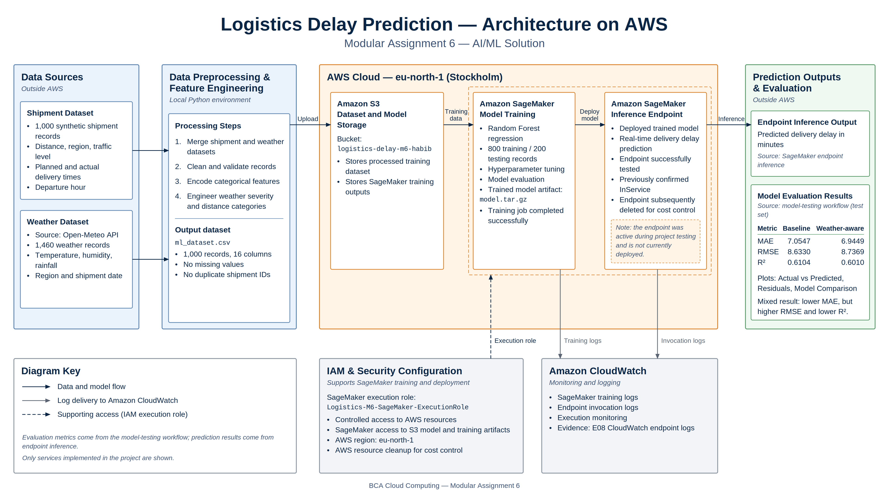
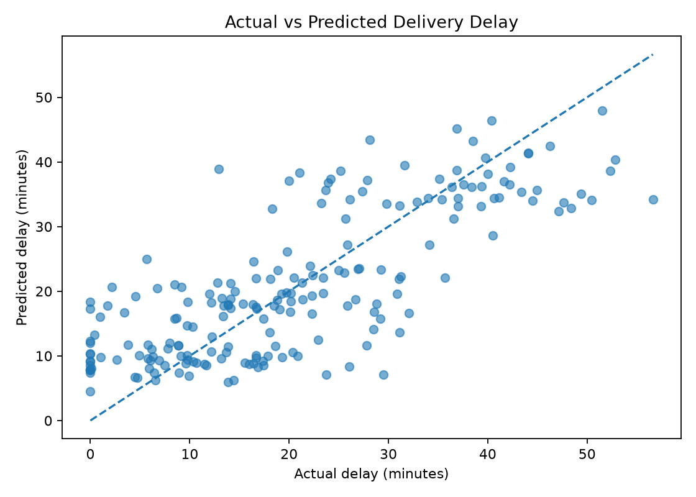
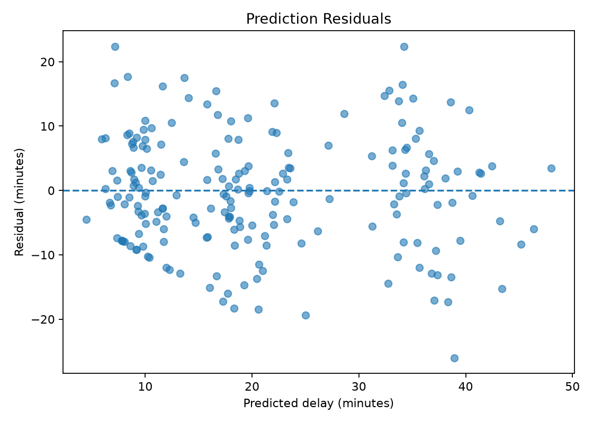
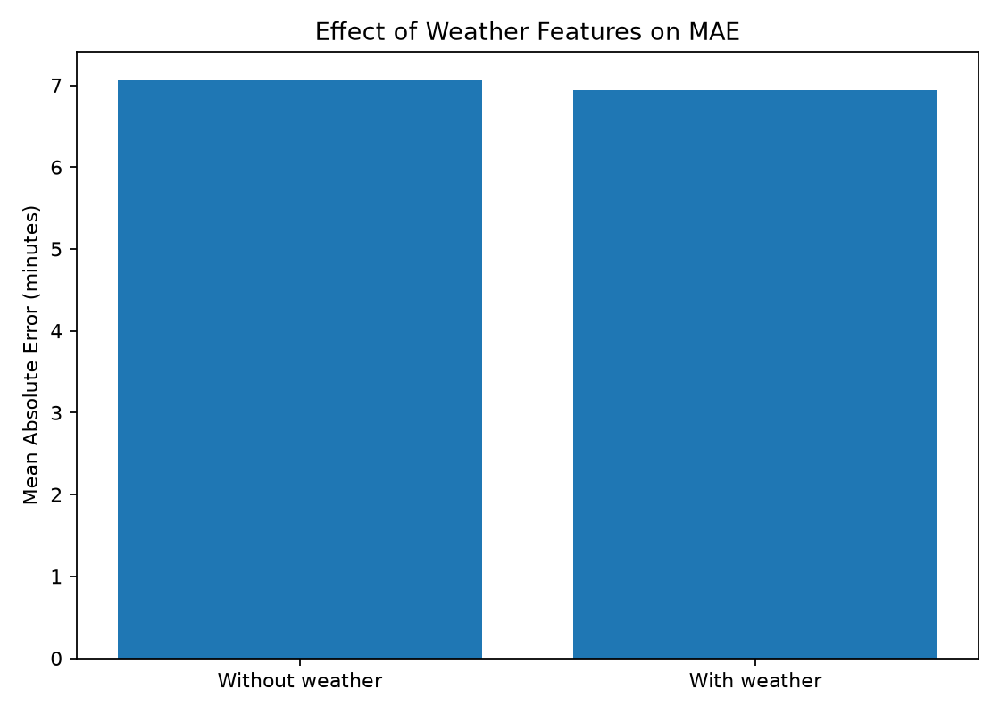

# Logistics Delay Prediction — Cloud Computing Modular Assignment 6

A cloud-based machine learning project for predicting shipment delivery delays using shipment, traffic, and weather information. The workflow combines Python data preparation, model evaluation, Amazon SageMaker training and inference, Amazon S3 artifact storage, and Amazon CloudWatch monitoring.

> **Project status:** SageMaker training and endpoint inference were completed and documented. The inference endpoint, endpoint configuration, and hosted model were subsequently deleted to avoid ongoing charges. The local inference model and downloaded SageMaker artifacts remain available in this repository.

## Objectives

- Prepare and validate shipment and weather datasets.
- Engineer predictive features and train a regression model.
- Compare a shipment-only baseline with a weather-aware model.
- Execute a training job and inference test using Amazon SageMaker.
- Preserve evaluation results, cloud execution evidence, and model artifacts.
- Demonstrate cost-aware cloud resource management.

## AWS architecture

The architecture below documents the implemented data pipeline, SageMaker training and inference, IAM execution role, and CloudWatch monitoring in **eu-north-1 (Stockholm)**.



[View the full-resolution architecture diagram](docs/diagrams/logistics_delay_architecture.png)

The SageMaker inference endpoint shown in the diagram was successfully tested and later deleted to control costs; it is **not currently running**.

## Technology stack

| Area | Technology |
| --- | --- |
| Programming and data processing | Python, pandas, NumPy |
| Machine learning | scikit-learn |
| Weather integration | Open-Meteo weather data |
| Cloud storage | Amazon S3 |
| Cloud training and inference | Amazon SageMaker |
| Monitoring | Amazon CloudWatch |
| Development and version control | VS Code, Jupyter, Git, GitHub |

## Dataset and preprocessing

The project uses **1,000 synthetic shipment records** and **1,460 weather records**. The final processed dataset has **1,000 rows and 16 columns**, with **zero missing values** and **zero duplicate shipment IDs**. Shipment and weather records are merged using their region and date fields.

Model input features:

1. `region`
2. `distance_km`
3. `traffic_level`
4. `departure_hour`
5. `planned_delivery_minutes`
6. `temperature_c`
7. `humidity_percent`
8. `rainfall_mm`

The target is shipment delay in minutes. Shipment delays were simulated for this academic experiment; the dataset is not a record of actual carrier delivery outcomes.

## Model training and evaluation

The processed data was split into **800 training records** and **200 test records**. The weather-aware model was tuned using the following selected hyperparameters: `n_estimators=200`, `max_depth=8`, and `min_samples_leaf=3`.

| Model | MAE (minutes) | RMSE (minutes) | R² |
| --- | ---: | ---: | ---: |
| Baseline without weather | 7.0547 | 8.6330 | 0.6104 |
| Weather-aware model | 6.9449 | 8.7369 | 0.6010 |

The weather-aware model achieved a slightly lower MAE, while the baseline achieved better RMSE and R². These results are reported as measured; they do not demonstrate consistent improvement across all evaluation metrics.

### Evaluation plots







The recorded metrics are also stored in [`models/evaluation_metrics.json`](models/evaluation_metrics.json).

## AWS implementation

**Region:** `eu-north-1` (Europe/Stockholm)

**S3 bucket used during the assignment:** `logistics-delay-m6-habib`

**SageMaker training job:** `logistics-delay-m6-training-2026-10-29-11-22-38-826`

**Training instance:** `ml.m5.large`

**SageMaker execution role:** `Logistics-M6-SageMaker-ExecutionRole`

**Historical inference endpoint:** `logistics-delay-m6-endpoint`

The SageMaker training job completed, the inference endpoint reached `InService`, and a prediction request was tested successfully. Endpoint logs were inspected in CloudWatch. The endpoint and associated serving resources have since been removed for cost control. The S3 bucket was retained pending final assignment packaging and cleanup.

The downloaded SageMaker archives are preserved as [`models/model.tar.gz`](models/model.tar.gz) and [`models/output.tar.gz`](models/output.tar.gz). Both archives were validated as readable gzip-compressed tar files.

## Project files and deliverables

**University report:** [AI/ML Solution — M6 Report (DOCX)](docs/AI-ML-Solution-M6-Report.docx)

**Architecture:** [Logistics Delay Prediction on AWS (PNG)](docs/diagrams/logistics_delay_architecture.png)

## Repository structure

| Folder | Purpose |
| --- | --- |
| `data/` | Raw shipment and weather data, plus the processed ML dataset |
| `scripts/` | Data collection, generation, preprocessing, and model training |
| `models/` | Trained model files, SageMaker archives, and evaluation metrics |
| `deployment/` | SageMaker training/inference source and local inference model |
| `notebooks/` | Reviewed notebook for local validation and cloud workflow documentation |
| `docs/evidence/` | E01–E08 implementation screenshots |
| `docs/plots/` | Three model evaluation visualizations |
| `docs/diagrams/` | Approved AWS architecture diagram |
| `docs/` | Final university DOCX report and supporting materials |

The repository also contains `requirements.txt`, the root `README.md`, and `.gitignore`. The notebook documents historical AWS execution and runs local validation; it does not automatically provision cloud infrastructure.

## Local setup and verification

From the project root, create and activate a virtual environment on Windows PowerShell:

```powershell
python -m venv .venv
.\.venv\Scripts\Activate.ps1
python -m pip install -r requirements.txt
```

Open `notebooks/01_sagemaker_training.ipynb` in VS Code or Jupyter and select the project environment as its kernel. The reviewed notebook provides four executable validation cells covering:

- Processed dataset integrity and a sample preview.
- Local inference using `deployment/local_model/model.joblib`.
- Saved evaluation metrics and plot existence.
- Validation of the downloaded SageMaker archive files.

The notebook also documents the historical cloud training and endpoint validation steps. It does **not** recreate an active SageMaker endpoint or automatically rerun cloud training.

A previously verified local inference test returned `predicted_delay_minutes: [46.47447984405663]` for its notebook sample input. This is a local prediction and is distinct from the historical cloud endpoint response.

## Evidence index

| Code | Evidence | File |
| --- | --- | --- |
| E01 | Weather API integration | [View](docs/evidence/E01-Weather-API-Integration.png) |
| E02 | Shipment dataset | [View](docs/evidence/E02-Shipment-Dataset.png) |
| E03 | Data preprocessing | [View](docs/evidence/E03-Data-Preprocessing.png) |
| E04 | S3 dataset upload | [View](docs/evidence/E04-S3-Dataset-Upload.png) |
| E05 | SageMaker training completed | [View](docs/evidence/E05-SageMaker-Training-Completed.png) |
| E06 | SageMaker endpoint InService | [View](docs/evidence/E06-SageMaker-Endpoint-InService.png) |
| E07 | SageMaker inference response | [View](docs/evidence/E07-SageMaker-Endpoint-Inference.png) |
| E08 | CloudWatch endpoint logs | [View](docs/evidence/E08-CloudWatch-Endpoint-Logs.png) |

## Cloud cost estimation and actual usage summary

**AWS region:** `eu-north-1` (Stockholm). The following actual amounts are from the supplied **October 2026 AWS Cost Explorer account-level breakdown**; they are not a separately itemized M6 project invoice.

| AWS service | Actual October 2026 (USD) | Cost estimation basis |
| --- | ---: | --- |
| Amazon SageMaker | $0.16 | Training instance-hours and temporary hosted endpoint uptime |
| Amazon S3 | $0.00 | Stored datasets and model artifacts; varies by GB-month |
| Amazon CloudWatch | $0.00 | Log ingestion and retention |
| AWS IoT, Glue and KMS | $0.00 | No billed usage in the supplied period breakdown |
| **Total** | **$0.16** | **Recorded account-level total** |

**Planning estimate:** For a comparable short training-and-test rerun, **approximately $0.16** is a historical-usage-based reference, **not a guaranteed quote**. Future cost depends on the SageMaker training and endpoint instance types, uptime, regional rates, S3 storage and CloudWatch usage. Exact hourly pricing and usage durations were not supplied, so a separately calculated instance-hour estimate is not asserted.

**Cost controls:** The inference endpoint, endpoint configuration and hosted model were deleted after successful testing. The S3 bucket remains temporarily retained pending submission cleanup. Displayed billing totals may change with subsequent AWS billing updates.

## Security and cost management

SageMaker used an execution role to access the resources required for model training and deployment. The implementation uses cloud service roles and S3 for dataset and artifact handling; permissions should be reviewed against least-privilege requirements before any future deployment. Credentials and `.env` files are excluded from version control by `.gitignore`.

The hosted SageMaker endpoint, endpoint configuration, and serving model were deleted after testing to avoid continuing inference hosting charges. The S3 bucket remains intentionally retained until final deliverables are complete; retained storage may still incur charges. Before any future cloud rerun, review SageMaker instance pricing, service quotas, IAM permissions, and resource cleanup requirements.

## Submission deliverables

- [Final university report (DOCX)](docs/AI-ML-Solution-M6-Report.docx)
- [AWS architecture diagram (PNG)](docs/diagrams/logistics_delay_architecture.png)
- [SageMaker notebook](notebooks/01_sagemaker_training.ipynb)
- [Evaluation metrics (JSON)](models/evaluation_metrics.json)
- [Evidence screenshots (E01–E08)](docs/evidence/)
- [Model evaluation plots](docs/plots/)

## Conclusion

The project demonstrates an end-to-end academic machine learning workflow: shipment and weather data preparation, validated feature engineering, model evaluation, managed SageMaker training and inference, CloudWatch evidence, and cost-aware resource cleanup. The preserved notebook, model artifacts, datasets, plots, and screenshots support inspection and local validation without requiring a live cloud endpoint.
